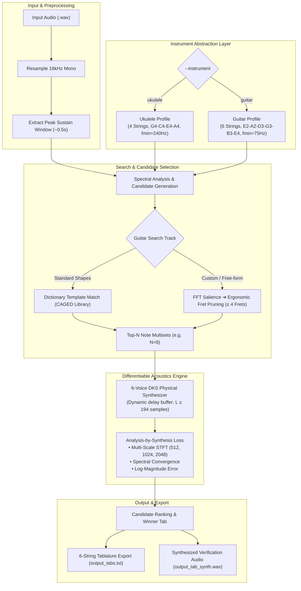

# Implementation Plan Report: Adding Guitar Mode to TabsGeneration

## Executive Summary

The **TabsGeneration** system currently performs automatic music transcription (AMT) for the standard 4-string concert ukulele using an analysis-by-synthesis pipeline: it combines Non-Negative Least Squares (NNLS) harmonic template matching, Differentiable Karplus-Strong (DKS) physical string modeling, and multi-scale STFT candidate audio comparison.

This report specifies the engineering roadmap to introduce **Guitar Mode** (Standard 6-String Guitar: $E_2 - A_2 - D_3 - G_3 - B_3 - E_4$). Because the core engine is grounded in physical acoustics rather than black-box statistical learning, the existing architecture can be generalized to 6 strings without requiring training datasets. 

---

## 1. Core Technical Challenges & Architectural Solutions

```
+---------------------------------------------------------------------------------------------------+
|                                     COMPARATIVE SPECIFICATIONS                                    |
+--------------------------+------------------------------------+-----------------------------------+
| Parameter                | Ukulele Mode (Existing)            | Guitar Mode (Target)              |
+--------------------------+------------------------------------+-----------------------------------+
| Strings                  | 4 (G4, C4, E4, A4)                 | 6 (E2, A2, D3, G3, B3, E4)        |
| Lowest Frequency (F0)    | C4 = 261.63 Hz                     | E2 = 82.41 Hz                     |
| Frequency Span           | ~240 Hz - 1050 Hz                  | ~75 Hz - 1350 Hz                  |
| Unconstrained Permutations| 16^4 = 65,536 shapes              | 16^6 = 16,777,216 shapes          |
| String Construction      | Uniform nylon / fluorocarbon       | 3 wound (E2,A2,D3) + 3 plain (G,B,E)|
| Delay Line Buffer (16kHz)| L = 16000 / 261.63 ≈ 61 samples    | L = 16000 / 82.41 ≈ 194 samples   |
+--------------------------+------------------------------------+-----------------------------------+
```

### Challenge 1: Combinatorial Explosion ($1.68 \times 10^7$ Shapes)
* **Problem:** In ukulele mode, evaluating $16^4 = 65{,}536$ shapes takes $< 50\text{ ms}$ in vectorized NumPy. For a 6-string guitar across 16 frets, $16^6 \approx 1.68 \times 10^7$ combinations would exhaust memory and cause unacceptable latency ($>30\text{ seconds}$ per chord).
* **Solution (Dual-Track Search Strategy):**
  1. **Standard Voicing Dictionary (Fast Path):** Match against a curated catalog of standard guitar chord voicings (CAGED open chords, barre shapes, and common jazz extensions) via Chroma CQT correlation in under $5\text{ ms}$.
  2. **Salience-Guided Note Reduction (Arbitrary Chords):** For uncataloged shapes, first extract the top 3–6 dominant active pitch frequencies from the FFT spectrum, then query the fretboard mapping for fingerings that satisfy those exact notes while enforcing an ergonomic human hand span ($\le 4$ frets). This collapses the search space from $16.8\text{M}$ to $< 200$ candidate shapes.

### Challenge 2: Low-Frequency Bass Resolution ($82.41\text{ Hz}$)
* **Problem:** Ukulele frequencies start at $261.6\text{ Hz}$. At guitar's lowest fundamental ($E_2 \approx 82.41\text{ Hz}$), the distance between adjacent semitones is small ($E_2 = 82.41\text{ Hz}$, $F_2 = 87.31\text{ Hz}$, difference $\Delta f = 4.90\text{ Hz}$).
* **Solution:**
  * At a sample rate $f_s = 16{,}000\text{ Hz}$ with $N_{\text{fft}} = 8192$, bin resolution is $\Delta f_{\text{bin}} = 16000 / 8192 \approx 1.95\text{ Hz}$. Because $1.95\text{ Hz} < 4.90\text{ Hz}$, an 8192-point FFT can distinguish adjacent bass notes.
  * Adjust `_FMIN` and `_POLY_FMIN` down from $240.0\text{ Hz}$ to $75.0\text{ Hz}$.

### Challenge 3: Physical Dispersion of Wound vs. Plain Strings
* **Problem:** Strings 6, 5, and 4 ($E_2, A_2, D_3$) use metal winding around a core wire, resulting in significantly different bending stiffness and damping compared to unwound nylon/plain steel strings 3, 2, and 1 ($G_3, B_3, E_4$).
* **Solution:**
  * Define differentiated physical inharmonicity prior coefficients $B_s$ per string in `expected_inharmonicity()`.
  * Wound strings exhibit lower inharmonicity coefficients relative to their fundamental than very short, thick plain strings of the same pitch.

---

## 2. Target System Architecture



---

## 3. Detailed Implementation Phases

### Phase 1: Instrument Profile Abstraction (`prototype/instrument_config.py`)
Decouple hardcoded ukulele constants into an extensible instrument profile module.

* **Tasks:**
  1. Create `prototype/instrument_config.py` with an `InstrumentProfile` dataclass.
  2. Implement `UKULELE_PROFILE` and `GUITAR_PROFILE`:
     ```python
     GUITAR_PROFILE = InstrumentProfile(
         name="guitar",
         num_strings=6,
         tuning={
             6: {"name": "E2", "freq": 82.41,  "midi": 40, "wound": True,  "inharm_base": 0.00015},
             5: {"name": "A2", "freq": 110.00, "midi": 45, "wound": True,  "inharm_base": 0.00020},
             4: {"name": "D3", "freq": 146.83, "midi": 50, "wound": True,  "inharm_base": 0.00025},
             3: {"name": "G3", "freq": 196.00, "midi": 55, "wound": False, "inharm_base": 0.00035},
             2: {"name": "B3", "freq": 246.94, "midi": 59, "wound": False, "inharm_base": 0.00045},
             1: {"name": "E4", "freq": 329.63, "midi": 64, "wound": False, "inharm_base": 0.00060},
         },
         fmin=75.0,
         fmax=1350.0,
         poly_fmin=75.0,
         max_fret=19,
         max_fret_span=4
     )
     ```

### Phase 2: Frequency Range & Pitch Estimation Updates (`pitch_estimation.py`)
Adapt the DSP front-end for lower bass frequencies.

* **Tasks:**
  1. Parameterize `_FMIN`, `_FMAX`, and `_POLY_FMIN` based on the selected instrument.
  2. In `estimate_initial_pitch()` (single note path):
     * Allow pYIN search bounds to expand down to $75\text{ Hz}$.
     * Extend modal MIDI snapping range down to MIDI 40 ($E_2$).
  3. In `_ukulele_salience_search()`:
     * Generalize to `_instrument_salience_search()` iterating across valid MIDI bounds ($40 \le m \le 88$ for guitar).

### Phase 3: Search Space Pruning for 6 Strings (`pitch_estimation.py` & `fretboard_mapper.py`)
Avoid brute-forcing $1.68 \times 10^7$ states while maintaining high accuracy.

* **Tasks:**
  1. **Add `GUITAR_CHORD_DEFINITIONS`:** Populate standard open and barre chord voicings for Major, Minor, 7th, Maj7, and m7 chords:
     * C Major: `(None, 3, 2, 0, 1, 0)`
     * G Major: `(3, 2, 0, 0, 0, 3)`
     * D Major: `(None, None, 0, 2, 3, 2)`
     * A Minor: `(None, 0, 2, 2, 1, 0)`
     * E Minor: `(0, 2, 2, 0, 0, 0)`
     * F Major (Barre): `(1, 3, 3, 2, 1, 1)`
  2. **Implement Salience-Pruned Search:**
     * For arbitrary plucks or non-standard chords, compute the 8192-point FFT.
     * Peak-pick the top $K$ dominant fundamentals ($3 \le K \le 6$).
     * Constrain the fret combinations strictly to fretboard coordinates that reproduce those detected pitch classes within a 4-fret hand span.
  3. **Preserve Overtone Discounting & Unison Bonuses:** Keep existing logic that discounts energy claims when higher notes coincide with lower string harmonics ($2f_0, 3f_0$).

### Phase 4: Differentiable Karplus-Strong Scalability (`karplus_strong.py`)
Scale the acoustic physical model from 4 to 6 polyphonic voices.

* **Tasks:**
  1. **Dynamic Buffer Sizing:**
     * Max delay line length $L_{\max} = \lceil f_s / f_{\min} \rceil + 10$.
     * At $16\text{ kHz}$ and $f_{\min} = 75\text{ Hz}$, $L_{\max} = \lceil 16000 / 75 \rceil + 10 = 224$ samples (up from 75 samples).
  2. **Vectorized 6-Voice Batching:**
     * Ensure tensor operations in `DifferentiableKSFunction` and `PolyphonicKarplusStrong` operate over dynamic batch dimensions `[B, V, T]` where $V=6$.
  3. **Wound String Damping Adjustments:**
     * Initialize decay factors $g_s$ with lower attenuation on low wound strings (strings 6, 5, 4 sustain longer than thin high strings).

### Phase 5: Formatting, Exporters & CLI Updates
* **Tasks:**
  1. Update `cli.py` to accept `--instrument {ukulele, guitar}` and pass it through to `main.py`.
  2. Update `tab_exporter.py` to support 6-string ASCII tab formatting:
     ```text
     e |--0--|
     B |--1--|
     G |--0--|
     D |--2--|
     A |--3--|
     E |--x--|
     ```
  3. Ensure `--strummed` validates valid subsets of $\{1, 2, 3, 4, 5, 6\}$.

---

## 4. Work Breakdown & Verification Milestones

| Milestone | Deliverables | Verification Criterion |
| :--- | :--- | :--- |
| **M1: Profile & DSP Core** | `instrument_config.py`, updated `pitch_estimation.py` | Detects isolated $E_2$ ($82.41\text{ Hz}$) synthetic and real audio with $< 1\text{ Hz}$ error. |
| **M2: 6-Voice DKS Synthesis** | Updated `karplus_strong.py`, longer buffer support | Synthesizes clean 6-string open guitar chords without clipping or buffer underflow. |
| **M3: Pruned Search Engine** | Vectorized fret pruning + chord dictionary | Generates top-8 chord candidates for full guitar strum in $< 250\text{ ms}$. |
| **M4: Audio Comparison & Verification** | End-to-end transcription of synthetic & real guitar chords | Successfully transcribes C Major, G Major, and E Minor with $\ge 95\%$ audio match. |
| **M5: Progression & Timeline** | Updated `chord_sequence.py` for guitar | Accurately identifies chord sequence transitions ($G \rightarrow C \rightarrow D$) across time. |

---

## 5. Potential Pitfalls & Mitigations

> [!WARNING]
> **Open vs. Muted Strings ($X$):**
> Unlike ukulele where all 4 strings are strummed in almost every standard chord, guitar chords frequently mute or omit strings (e.g. String 6 in C Major, Strings 6 and 5 in D Major).
> **Mitigation:** The candidate generator must support `None` / `muted` state for individual voices, assigning zero synthetic amplitude during candidate audio comparison.

> [!TIP]
> **GPU Memory Optimization:**
> Expanding to 6 voices and longer delay lines increases tensor allocations slightly, but well within modern GPU limits ($< 50\text{ MB}$ VRAM on CUDA). JIT recurrence in `karplus_strong.py` remains the optimal execution path.
